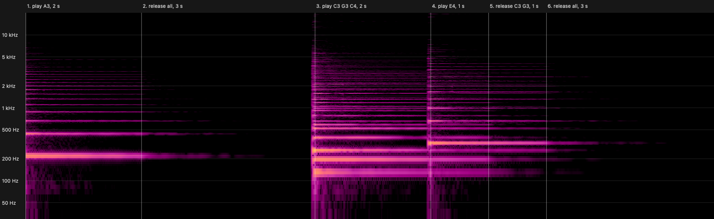

# auv3-stress

A stress test for macOS Audio Units, run the way a host runs them: **out of process**, with
real-world abuse — sample-rate and block-size changes, parameter fuzz, automation inside render,
MIDI fuzz, state saved and restored (also while rendering, also corrupted), several instances at
once, open/close cycles, hostile audio and MIDI (NaN, DC, SysEx, 512 notes at once), a render
clock that has been running for a day, and the editor opened, resized and closed while audio plays.
Every random choice comes from a seed, so a run that found something can be repeated.

It was written for AUv3 app extensions, and tests AUv2 components the same way (macOS hosts
those out of process too, in its AU hosting service).

[Install](#install) · [Use](#use) · [What it checks](#what-it-checks) · [Scenarios](#scenarios) ·
[Results](#results) · [Common findings](#common-findings) · [Limitations](#limitations)

```
$ auv3-stress aufx dely appl --no-editor --seed 42
auv3-stress 0.1.0: aufx dely appl, seed 42

▸ 1. Instantiate out of process
    Apple: AUDelay v1.6.0, effect, v3: false, sandbox-safe: true
  ✓ instantiated in 187 ms, in process: false
  …
▸ 6. Parameter fuzz
  ✓ 40 rounds of every parameter random, rendering between: peak 2
  ! WARN [6. Parameter fuzz] every parameter far above max, then far below min: 57600 NaN/Inf samples
  ! WARN [6. Parameter fuzz] 4 parameters keep an out-of-range host value: 0, 1, 2, 3
  ✓ every parameter reads back what the host set
  …
▸ 9. Threads: render, parameter writes and state reads at once
  ✓ 3 s of rendering, with 4443 parameter writes from another thread and 40 state reads: peak 5.02
  …
▸ 12. Render time
  ✓ 256-frame buffers (5.33 ms) in real time, on a real-time thread: render takes 0.8% of the
    buffer's time (median), 2.3% at the 99th percentile, worst call 0.16 ms, 0 of 750 late
  …
▸ 14. Timeline: cycles, a day-long session, pre-roll, offline
  ✓ the render clock past 2³¹ samples (12.4 h of rendering at 48 kHz): peak 0.534
  ✓ offline bounce (isRenderingOffline, 4096-frame buffers): peak 0.472

▸ 15. Tail, reset, latency and bypass
  ✓ quiet 11.00 s after the input and the notes stop (tailTime 20.93 s)
  ✓ reset() leaves nothing sounding
  ✓ bypassed, the input comes out untouched

▸ 16. Hostile input
  ! WARN [16. Hostile input] 0.1 s of NaN/Inf input: the output stays NaN/Inf until the host
    calls reset() (it is kept in a delay line or a filter: sanitise the input, or clear state
    that isn't finite)
  …
▸ 20. Corrupted state
  ✓ 7 garbage states (empty; keys as random bytes, strings, missing): still renders

▸ 21. Crash reports
  ✓ no crash reports (AUHostingService, AUDelay) since the run started

PASSED: 0 failed, 4 warnings, 22 s, seed 42
```

(Apple's own delay, 21 sections in 22 seconds; `…` marks where this listing is cut.)

It goes where the usual tools stop:

- **auval** checks the render contract and parameter plumbing, but not state, threads, automation
  as render events, the editor, or what happens when the extension process dies.
- **[pluginval](https://github.com/Tracktion/pluginval)** is a thorough validator for every
  plug-in format, hosting through JUCE. auv3-stress hosts through `AUAudioUnit` itself and stays
  with what is particular to Audio Units: render events, the keys of a `fullState` dictionary,
  the transport and musical-context blocks, the extension process and its crash reports.

Bugs it has found in shipping AUv3s include a data race between the host's parameter thread and
the editor (an index-out-of-range crash), render-event automation that never reached the sound,
host parameters read back truncated instead of rounded, and extensions that crash on a corrupted
state (see [Common findings](#common-findings)).

[auv3-test](https://github.com/sufystudios/auv3-test) is a tool of the same kind, with its weight
on how a unit behaves when it is used properly, and it runs on iOS too. The two go well together.

## Install

Needs macOS 13 or later and Swift 5.10 or later (Xcode 15.3+). No dependencies but Apple's
frameworks.

```sh
git clone https://github.com/zhiii0x/auv3-stress.git
cd auv3-stress
swift build -c release
.build/release/auv3-stress --list
```

Or run it without installing: `swift run -c release auv3-stress aumu dls appl`.

## Use

```sh
auv3-stress --list                    # every Audio Unit on this Mac, with its codes
auv3-stress aumu dls appl             # Apple's DLS synth
auv3-stress aufx dely appl --no-editor
auv3-stress aumu Abcd Manu --skip 96,100-111 --json result.json
auv3-stress aumu Abcd Manu --seed 123456789      # repeat the run that printed this seed
auv3-stress aumu Abcd Manu --no-editor --strict --junit auv3-stress.xml   # in CI
auv3-stress aumu dls appl --scenario Examples/instrument-tour.json --spectrogram tour.png
```

The three codes are the unit's type, subtype and manufacturer (`auv3-stress --list` prints them;
codes shorter than four characters are padded with spaces, as Apple's are). An AUv3 is registered
once its container app has been launched.

| Option | |
|---|---|
| `--skip <addresses>` | Parameters to leave out of fuzzing, read-back and state comparisons, e.g. `96,100-111`. For ones reset on purpose on restore, mode switches that silence the unit, or parameters that only exist in some configurations. |
| `--no-editor` | Skip the editor checks. Without it, editor windows appear on screen for about 15 seconds. |
| `--json <path>` | Also write every result to a JSON file (for CI). It records the seed. |
| `--junit <path>` | Also write them as JUnit XML: a test suite per section, a test case per check. |
| `--save-audio <dir>` | Save what was rendered there as 32-bit float WAV files, to listen to what the checks measured. One file per host a section sets up, named `<section>-<order>-<rate>Hz.wav` (about 60 files and 60 MB a run). |
| `--scenario <json>` | Play a [scenario](#scenarios) and judge each step, instead of the standard checks. |
| `--spectrogram <png>` | With `--scenario`: a spectrogram of what it played, with the steps marked. |
| `--snapshot <png>` | Save a picture of the editor's window, the unit's own drawing included. The window is raised above other apps for the shot. Needs the Screen Recording permission for the terminal, and macOS 14. Not with `--no-editor`. |
| `--window-size <WxH>` | Open the editor at this content size in points (e.g. `1400x460`) instead of 800×560. |
| `--seed <number>` | Repeat a run. Every run prints its seed; the same seed gives the same random parameter values, MIDI, block sizes and garbage. (How they interleave with the render thread in the concurrent sections still depends on timing.) |
| `--strict` | Warnings fail the run too. |
| `--list` | List the installed Audio Units. |
| `--version` | Print the version. |

Exit status: `0` passed, `1` failed (or warned, with `--strict`), `2` hung (15-minute watchdog),
`64` usage error.

A run takes 30–60 seconds for a small unit and a couple of minutes for one with hundreds of
parameters, plus a minute when the extension dies (the wait for its crash report). It needs a
logged-in desktop session for the editor checks; on a headless machine use `--no-editor`.

## What it checks

| # | Section | |
|---|---|---|
| 1 | Instantiate | Loads the unit out of process; reports its buses, parameters, presets, MIDI outputs, latency, tail. An instrument without MIDI input fails. |
| 2 | Parameter definitions | Unique addresses and identifiers, a finite range with min < max, defaults in range, value strings matching the range, readable or writable, display strings. Read-only parameters (meters) are left out of everything that writes or restores parameters. |
| 3 | Sample rates × block sizes | 44.1 / 48 / 96 kHz × 64…1024 frames, a second each. Refusing 96 kHz is a warning; refusing 44.1 or 48 kHz fails. |
| 4 | Variable block sizes | 2000 buffers of random length; a buffer over `maximumFramesToRender` must be refused. |
| 5 | Host transport and MIDI out | Musical context and transport blocks, tempo changes (40/300/97.3 BPM), locate jumps; MIDI-out notes closed after stop, MIDI-out timestamps inside their buffer. |
| 6 | Parameter fuzz | Every parameter random for 40 rounds while rendering; far out of range; clamping; read-back (a stepped parameter may round, not truncate). |
| 7 | Automation and MIDI in | Parameter events and ramps inside render, and whether render kept time under them; whether it still plays once they stop; whether render-event automation of a gain-like parameter reaches the sound like a tree write does; random MIDI (notes, CC, program change, pitch bend, clock, start/stop, SPP), then a reset. |
| 8 | State | Save → change → restore on the same instance and on a fresh one (a reopened project); factory presets (loading, reading back, sounding, and loading in under half a second); 30 state and preset loads while rendering; `fullStateForDocument`. |
| 9 | Threads | Three seconds of rendering, parameter writes from another thread and state reads, all at once. |
| 10 | Several instances | Four instances rendering on four threads. Then two side by side: what is played into the second must not sound in the first, and the second's parameters must leave the first's values and level alone. |
| 11 | Open/close cycles | Eight instantiate → allocate → render → deallocate cycles; re-allocation at seven sample rates; the extension's memory. |
| 12 | Render time | How long render calls take against how long their buffers last, at 256 and 64 frames, and idle: on a real-time thread that asks for a buffer every buffer's worth of time, as an audio device does. Measured from the host, so the trip to the extension is included. |
| 13 | Channel layouts | The mono layouts in `channelCapabilities` (1→1, 1→2, 2→1; mono out for an instrument): accepted, and rendering. |
| 14 | Timeline | The playhead cycling and starting below zero (count-in); the render clock restarting from zero; the render clock past 2³¹ and 2³² samples (12 and 25 hours at 48 kHz); an offline bounce in 4096-frame buffers. |
| 15 | Tail, reset, latency, bypass | How long it sounds after the input and the notes stop, against `tailTime`; silence after `reset()`; where the direct sound of an impulse comes out, against `latency`; with `shouldBypassEffect` on, the input coming out untouched, and the switch itself not clicking. |
| 16 | Hostile input | Silence, DC, a full-scale square, a sine at +24 dB, an impulse, denormals (and whether they slow render down); then 0.1 s of NaN/Inf, and whether the output is clean again afterwards. |
| 17 | MIDI abuse | 512 notes in one buffer, notes that don't pair up, SysEx (1 kB; unterminated), messages cut short or out of spec, immediate and already-past timestamps, cables 1–15. After each: does it still play? At the end: does it go quiet? |
| 18 | Sound | Clicks: each smoothly variable parameter (48 of them, picked by the seed, if there are more) jumps between ¼ and ¾ of its range while a chord or a tone holds; a click is a step between samples over 4× sharper than the steady sound has on either side, both ways. Pitch: A3 held at 44.1, 48 and 96 kHz must be the same note. |
| 19 | Editor | Opened, resized, closed and reopened while audio runs; a sample-rate change under it; three instances with editors open. |
| 20 | Corrupted state | An empty state, then each top-level key of a real one as random bytes, as a string, and missing. Last, because it can kill the extension. |
| 21 | Crash reports | New crash reports from the extension or the AU hosting service. If the extension died, waits up to 60 s for macOS to write the report. |

Sections 7, 8, 9 and 19 also warn when a single render call takes over 100 ms, or more than 2% of
them outlast their buffer: render was waiting for whatever the state load, the parameter write or
the editor was holding.

What the host feeds in: instruments, music effects and MIDI processors get a note every quarter
second (a C-major arpeggio on channel 1); every input bus gets the same 220 Hz sine with a
little noise at −12 dB.

## Scenarios

A scenario plays the unit step by step, as someone trying it would, and judges what each step
sounded like. It runs instead of the standard checks, in a second or two.

```json
{ "name": "Filter and delay",
  "steps": [
    { "play": [48, 55, 60], "for": 2, "expect": "sound" },
    { "sweep": "cutoff", "from": 200, "to": 8000, "over": 4, "expect": "no-click" },
    { "set": "delayWet", "to": "50%", "for": 2 },
    { "release": "all", "for": 3, "expect": "silence" },
    { "play": 57, "for": 2, "expect": ["sound", "in-tune"] } ] }
```

| Step | Does | Lasts (default) |
|---|---|---|
| `"play": 60` or `[48, 55]` | note-ons, held until released (`"velocity"` 1–127, default 100) | `"for"` (2 s) |
| `"release": "all"` or notes | note-offs | `"for"` (2 s), to hear the tail |
| `"set": "<parameter>", "to": v` | a parameter-tree write | `"for"` (1 s) |
| `"sweep": "<parameter>", "from": a, "to": b` | a render event on every buffer; a parameter in hertz sweeps evenly in pitch | `"over"` (4 s) |
| `"wait": 3` | nothing | that long |

A parameter is named by its identifier, its display name or its address; a value is a number, or
`"50%"` of the range. Any step can also carry `"input"` (`tone`, `noise`, `impulse`, `silence`:
what goes into an effect from then on; a 220 Hz tone to begin with) and `"expect"`, one or several
of the ones below. Next to `"name"` and `"steps"`, `"sampleRate"` sets the rate (48000 if left out).

| `expect` | Fails when |
|---|---|
| `sound` | the step is silent |
| `silence` | the last fifth of the step still sounds (the tail gets the rest) |
| `in-tune` | the lowest held note is more than 25 cents off (a warning when it has no clear pitch) |
| `no-click` | the step has an edge between samples over 4× sharper than the step before it (a warning when that step was silent, or there is none: nothing to compare with) |

Every step fails on a render error or NaN/Inf. Without `expect`, a step reports its peak. Two
examples are in [Examples](Examples).



`auv3-stress aumu dls appl --scenario Examples/instrument-tour.json --spectrogram tour.png`:
frequency against time, with a line where each step starts.

## Results

- **FAIL** — something a host can hit: a render error, NaN/Inf, a blow-up, a crash, a parameter
  that doesn't restore, a buffer over the limit accepted, an editor that doesn't open, a layout in
  `channelCapabilities` that is refused, an instrument that no longer plays after odd MIDI, render
  slower than real time, one instance sounding in or changing another, a pitch that follows the
  sample rate.
- **WARN** — worth a look, possibly by design: silence where sound was expected, clipping,
  parameters that keep out-of-range values, read-back that differs, a state that reads back
  differently, notes left hanging, render-event automation ignored, sound after `reset()` or past
  the reported tail, NaN that stays after a bad input buffer, a bypass that changes the signal or
  clicks, a parameter jump that clicks, a direct sound away from the reported latency, a slow
  preset, a render call that stalls.
- Plain lines are information.

While parameters are random, loud output is reported as information (a +40 dB gain is allowed to
be loud), and NaN/Inf from out-of-range values is a warning rather than a failure.

## Common findings

**The extension crashes on a corrupted state.** `AUAudioUnit`'s own `fullState` setter
deserializes the parameter values under the `"data"` key, and raises an Objective-C exception
when they're malformed — which Swift can't catch, so the extension dies. An override that passes
an untrusted state straight to `super.fullState` inherits that. Check the state before handing it
on (or leave out `"data"` and restore parameters from your own model).

**Render-event automation is ignored.** Hosts play automation back sample-accurately as render
events (`AURenderEvent` parameter and ramp events), not as parameter-tree writes. A unit that only
listens to `implementorValueObserver` never hears it.

**Parameters don't show a restored state.** After `fullState` is set, the parameter tree should
read the restored values; some units only catch up once render resources are allocated.

**NaN that never leaves.** One buffer of NaN from a plug-in upstream gets into a delay line or a
filter's state, and every sample after it is NaN: the track is dead until the host resets the
unit. Apple's own AUDelay does this. Replace non-finite input with zero, or clear any state that
isn't finite at the end of render.

**Quiet, or silent, a day into a session.** Sample times kept in 32 bits, or converted to
`Float`, stop resolving single samples long before a host's render clock stops counting: at
48 kHz, 2³¹ samples is 12.4 hours. Notes and automation land late or not at all. Keep event times
as `Int64` (`AUEventSampleTime`) and subtract the buffer's start before narrowing.

**Sound after `reset()`.** Hosts reset a unit when the transport stops or locates, expecting
delay lines, filters and voices cleared. What isn't cleared plays at the wrong place on the
timeline.

**A parameter jump clicks.** Stepped automation, a preset change or a MIDI-learned knob moves a
gain or a mix from one value to another between two buffers. Applied in one sample, that is a step
in the waveform. Ramp to the new value over a few milliseconds. Apple's AUDynamicsProcessor
(master gain) and AUNBandEQ (global gain) do click.

**Out-of-range host values.** Hosts clamp what their UI sends, but scripts, MIDI learn and other
plug-ins don't always: clamp in the observer, and never produce NaN.

## Limitations

- macOS only, and always out of process. An iOS-only AUv3 can't be tested unless it also ships
  for macOS (whether Apple Silicon Macs can load iOS AUv3s this way is untested).
- Only output bus 0 is rendered; side-chains and extra outputs are not exercised. Layouts are
  mono and stereo; surround is not tried.
- Section 12 times render on a real-time thread at real-time pace. Everywhere else render runs
  as fast as it can on an ordinary thread, where a single slow call can be the scheduler's.
- MIDI processors (`aumi`) are supported in principle but haven't been tried yet.
- User presets aren't tested (saving one writes to the user's disk).

## Development

```sh
swift build
swift test     # the analysis, the command line, the seed and the WAV writer; no Audio Unit is loaded
```

The checks themselves are tried against Apple's units, which every Mac has: `aumu dls appl`
(an instrument), `aufx dely appl` and `aufx dcmp appl` (effects).

## License

Copyright (c) 2026 zhiii0x.

auv3-stress is free software: you can redistribute it and/or modify it under the terms of the
GNU General Public License as published by the Free Software Foundation, either version 3 of the
License, or (at your option) any later version. It is distributed in the hope that it will be
useful, but without any warranty; see [LICENSE](LICENSE) for the details.

The license covers the tool. Running it on your own Audio Units puts no conditions on them, or
on the reports it writes.
